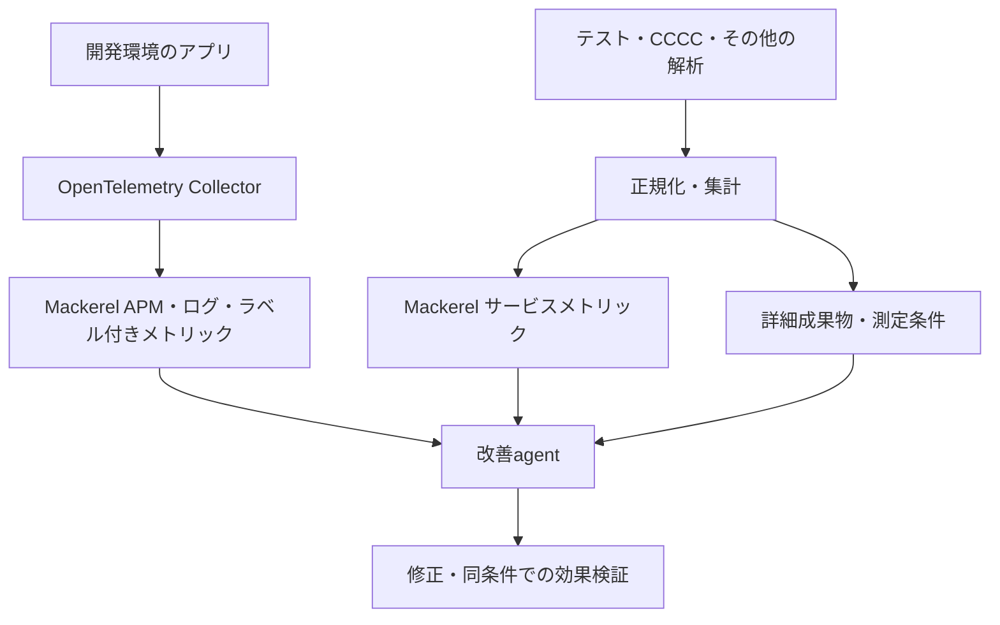

# mackerel-DevImprove-agent-skills

Mackerelを活用した開発改善のためのagent Skillsを保存するリポジトリです。OpenTelemetry・[moznion/cccc](https://github.com/moznion/cccc)を組み合わせ、開発環境の性能、テスト結果、コード複雑度を観測し、改善と効果検証を進めます。

最初のSkillとして、導入から検証までを扱う `mackerel-dev-improve` を収録しています。

テストケース数・試行数・CI実行数を区別し、認知複雑度・循環的複雑度、カバレッジ、変更履歴、不具合を照合します。指標の低下だけで改善と判定せず、測定の完全性と変更前後の挙動を確認します。

## 内容

- [Skill本体](skills/mackerel-dev-improve/SKILL.md)：導入・調査・改善・検証の手順
- [計測契約](skills/mackerel-dev-improve/references/measurement-contract.md)：系列、母数、測定条件、成果物の対応
- [テスト結果](skills/mackerel-dev-improve/references/test-results.md)：成否、実行数、再試行、カバレッジ、CRAP
- [CCCCアダプター](skills/mackerel-dev-improve/references/cccc-adapter.md)：moznion/ccccのJSONと認知・循環的複雑度
- [Mackerelダッシュボード](skills/mackerel-dev-improve/references/mackerel-dashboard.md)：投稿、可視化、agentの参照手順
- [OTel導入](skills/mackerel-dev-improve/references/otel-setup.md)：APM・ログ・実行時メトリック
- [改善判断](skills/mackerel-dev-improve/references/decision-policy.md)：閾値、優先順位、効果検証
- [プロジェクト設定例](skills/mackerel-dev-improve/assets/project.example.yaml)
- [レポート変換・投稿CLI](skills/mackerel-dev-improve/references/report-tools.md)：対応範囲、JSON設定、実行手順、検証方法

## 利用

`skills/mackerel-dev-improve`フォルダー全体を、利用するagentが対応するSkill配置先へ登録してください。`SKILL.md`から必要な参照資料を読み、対象プロジェクトの言語・CI・テストランナーに合わせて導入します。

依頼例：

```text
mackerel-dev-improveを使い、このプロジェクトのテスト結果とmoznion/ccccの
複雑度をMackerelで可視化する構成を作成してください。
既存のCI・テストコマンドを確認し、OTelのAPM・ログと照合できるようにしてください。
```

`project.example.yaml`はこのSkill独自の設定契約を示す例です。CollectorやCCCCがそのまま読み込む設定でも、自動実行するプログラムでもありません。サービス名、解析対象、計測プロファイル、閾値は利用先で設定します。

## データの流れ



## 実装状況

Skillの手順・計測仕様に加え、PHPUnit 12.5のJUnit XMLとmoznion/cccc 1.8.3の全件JSONを取り込む[正規化スクリプト](skills/mackerel-dev-improve/scripts/normalize.py)を収録しています。完全性を確認した固定系列、明細、checksum付きmanifestを生成します。[実行可能なJSON設定例](skills/mackerel-dev-improve/assets/project.example.json)と[run例](skills/mackerel-dev-improve/assets/run.example.json)は、このCLI用です。既存のYAML例は引き続き、より広い計測契約の設計例です。

Mackerelへの投稿は[投稿スクリプト](skills/mackerel-dev-improve/scripts/publish.py)で行います。[レポートツールの利用手順](skills/mackerel-dev-improve/references/report-tools.md)で、CIの単一publisher、秘密管理、API読戻しの条件を確認してください。OTelの導入、未対応ランナーの変換、ダッシュボード適用は対象プロジェクトで設定します。スクリプトのテスト合格だけを、利用先の実データ投稿やダッシュボード表示の検証済みとは扱いません。

送信先は通常`--expected-org`で固定します。利用者がキーの所属先を選ぶと明示した場合は`--use-key-organization`を使えます。所属名はプロセス内部だけで照合し、ログや成果物へ出力しません。この指定では、将来キーの所属先が変われば送信先も変わります。詳しくは[投稿手順](skills/mackerel-dev-improve/references/report-tools.md#mackerelへの投稿)を参照してください。

製品仕様の確認日は2026-10-26です。利用時は採用するツールの版を固定し、リンク先の公式仕様と実出力を確認してください。
